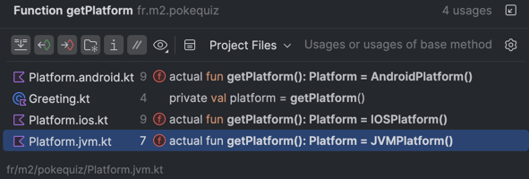
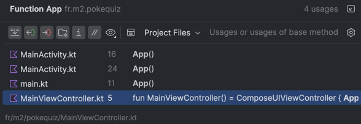
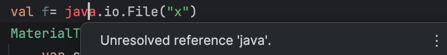

# Réponse aux questions du lab1

1. Combien de modules Gradle contient le projet ? Lesquels ? Où sont-ils déclarés ?
   iosApp en fait-il partie ? Pourquoi ?
> - Dans settings.gradle.kts, on voit que le projet contient 3 modules Gradle : ":androidApp", ":desktopApp" et ":shared". 
> - Ils sont déclarés tout en bas du fichier settings.gradle.kts.
> - iosApp n'en fait pas partie car il est géré en dehors de Gradle, par XCode. 

2. Quelles versions de Kotlin, Compose Multiplatform, AGP et Gradle sont utilisées ?
> - Dans gradle/libs.versions.toml, on peut voir que Kotlin est en version 2.4.20, Compose Multiplatform en 1.12.1 et AGP en 9.1.1.
> - Pour Gradle, on voit l'info dans gradle/wrapper/gradle-wrapper.properties : 9.5.1 (on a l'info dans l'URL).

3. Quels plugins applique shared/build.gradle.kts ? Et androidApp/build.gradle.kts ? Pourquoi androidApp n'applique-t-il pas
   org.jetbrains.kotlin.android ?
> - Dans shared/build.gradle.kts, le fichier applique les plugins multiplateformes (pour éviter de les reloader pour chaque plateforme (comme précisé dans le fichier)) : kotlin.multiplatform, com.android.kotlin.multiplatform.library, org.jetbrains.compose et le compilateur Compose
> - Dans androidApp/build.gradle.kts, com.android.application + le compilateur Compose.
> - androidApp n'applique pas org.jetbrains.kotlin.android  car le support de Kotlin pour Android est déjà intégré dans com.android.application.

4. Où sont configurés le minSdk de la bibliothèque partagée et celui de l'application ?
   Sous quelle forme (valeur en dur ou catalog) ?
> - minSdk de la bibliothèque partagée : dans shared/build.gradle.kts
> - minSdk de l'app : dans androidApp/build.gradle.kts
> - La valeur provient du catalog (gradle/libs.versions.toml, android-minSdk = "24") dans les deux cas.

5. Listez les dossiers de shared/src/ . Pourquoi n'y a-t-il pas de iosArm64Main alors que la cible iosArm64() est déclarée ? 
> - Dossiers de shared/src/ : androidHostTest, androidMain, commonMain, commonTest, iosMain, iosTest, jvmMain, jvmTest.
> - Pas de dossier iosArm64Main car ... TODO

6. Où est déclarée expect fun getPlatform() ? Combien d'actual existe-t-il, et dans quels fichiers ?
> - expect fun expect getPlatform() est déclaré dans shared/src/commonMain/kotlin/fr/m2/pokequiz/Platform.kt.
> - Il existe 3 actual : Platform.android.kt (androidMain), Platform.ios.kt (iosMain), Platform.jvm.kt (jvmMain).

7. Quel est l'applicationId Android ? Quelle est la mainClass desktop, et pourquoi se termine-t-elle par Kt ?
> - applicationId = fr.m2.pokequiz (visible dans androidApp/build.gradle.kts)
> - mainClass = fr.m2.pokequiz.MainKt
> - Kotlin génère automatiquement une classe nommée d'après le fichier et ajoute "Kt" pour les fonctions top-level : main.kt donne MainKt, qui contient le main().

8. Où la fonction App () est-elle définie ? Depuis combien d'endroits est-elle appelée, et lesquels ?
> - App() est définie dans shared/src/commonMain/kotlin/fr.m2.pokequiz/App.kt.
> - App() est appelée à 3 endroits : MainActivity.kt, main.kt et MainViewController.kt

9. Que contient le •gitignore généré ? Pourquoi local.properties doit-il être ignoré ?
> - le .gitignore ignore les dossiers de build et caches (.gradle, .kotlin, build/), les fichiers d'IDE/IntelliJ (.idea, *.iml), les fichiers Xcode et local.properties.
> - local.properties doit être ignoré car il contient le lien vers le SDK Android de ma machine, il est donc propre à chaque machine.

10. Dans shared/src/commonMain/.../App.kt, ajoutez temporairement val f= java.io.File("x") dans App () . Que dit l'IDE ? Pourquoi ? (Supprimez la ligne ensuite.)
> - l'IDE affiche le message "unresolved reference"
> - ce qui est dans commonMain est compilé pour toutes les plateformes et iOS n'a pas de JVM, les classes Java n'y existent pas (par contre, pas de souci pour les utiliser dans androidMain ou jvmMain par exemple).
