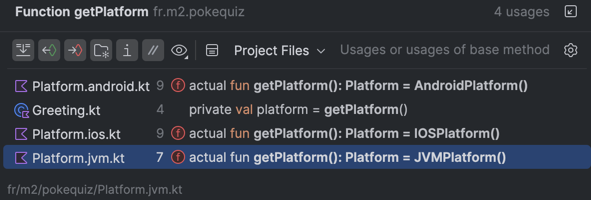
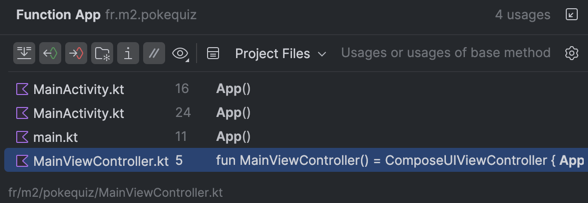
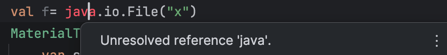
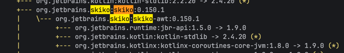

# Réponse aux questions du lab1

## Étape 5 : exploration de l'arborescence
1. Combien de modules Gradle contient le projet ? Lesquels ? Où sont-ils déclarés ?
   iosApp en fait-il partie ? Pourquoi ?
> - Dans settings.gradle.kts, on voit que le projet contient 3 modules Gradle : ":androidApp", ":desktopApp" et ":shared". 
> - Ils sont déclarés tout en bas du fichier settings.gradle.kts.
> - iosApp n'en fait pas partie car il est géré en dehors de Gradle, par XCode. 

2. Quelles versions de Kotlin, Compose Multiplatform, AGP et Gradle sont utilisées ?
> - Dans gradle/libs.versions.toml, on peut voir que Kotlin est en version 2.4.20, Compose Multiplatform en 1.12.1 et AGP en 9.1.1.
> - Pour Gradle, on voit l'info dans gradle/wrapper/gradle-wrapper.properties : 9.5.1 (on a l'info dans l'URL).

3. Quels plugins applique shared/build.gradle.kts ? Et androidApp/build.gradle.kts ? Pourquoi androidApp n'applique-t-il pas
   org.jetbrains.kotlin.android ?
> - Dans shared/build.gradle.kts, le fichier applique les plugins multiplateformes (pour éviter de les reloader pour chaque plateforme (comme précisé dans le fichier)) : kotlin.multiplatform, com.android.kotlin.multiplatform.library, org.jetbrains.compose et le compilateur Compose
> - Dans androidApp/build.gradle.kts, com.android.application + le compilateur Compose.
> - androidApp n'applique pas org.jetbrains.kotlin.android  car le support de Kotlin pour Android est déjà intégré dans com.android.application.

4. Où sont configurés le minSdk de la bibliothèque partagée et celui de l'application ?
   Sous quelle forme (valeur en dur ou catalog) ?
> - minSdk de la bibliothèque partagée : dans shared/build.gradle.kts
> - minSdk de l'app : dans androidApp/build.gradle.kts
> - La valeur provient du catalog (gradle/libs.versions.toml, android-minSdk = "24") dans les deux cas.

5. Listez les dossiers de shared/src/ . Pourquoi n'y a-t-il pas de iosArm64Main alors que la cible iosArm64() est déclarée ? 
> - Dossiers de shared/src/ : androidHostTest, androidMain, commonMain, commonTest, iosMain, iosTest, jvmMain, jvmTest.
> - Pas de dossier iosArm64Main car le code commun à iOS est écrit une seule fois dans iosMain. iosMain est donc partagé par iosArm64, iosSimulatorArm64 et iosX64. Un dossier iosArm64Main n’existe que pour du code spécifique à cette archi

6. Où est déclarée expect fun getPlatform() ? Combien d'actual existe-t-il, et dans quels fichiers ?
> - expect fun expect getPlatform() est déclaré dans shared/src/commonMain/kotlin/fr/m2/pokequiz/Platform.kt.
> - Il existe 3 actual : Platform.android.kt (androidMain), Platform.ios.kt (iosMain), Platform.jvm.kt (jvmMain).

7. Quel est l'applicationId Android ? Quelle est la mainClass desktop, et pourquoi se termine-t-elle par Kt ?
> - applicationId = fr.m2.pokequiz (visible dans androidApp/build.gradle.kts)
> - mainClass = fr.m2.pokequiz.MainKt
> - Kotlin génère automatiquement une classe nommée d'après le fichier et ajoute "Kt" pour les fonctions top-level : main.kt donne MainKt, qui contient le main().

8. Où la fonction App () est-elle définie ? Depuis combien d'endroits est-elle appelée, et lesquels ?
> - App() est définie dans shared/src/commonMain/kotlin/fr.m2.pokequiz/App.kt.
> - App() est appelée à 3 endroits : MainActivity.kt, main.kt et MainViewController.kt

9. Que contient le •gitignore généré ? Pourquoi local.properties doit-il être ignoré ?
> - le .gitignore ignore les dossiers de build et caches (.gradle, .kotlin, build/), les fichiers d'IDE/IntelliJ (.idea, *.iml), les fichiers Xcode et local.properties.
> - local.properties doit être ignoré car il contient le lien vers le SDK Android de ma machine, il est donc propre à chaque machine.

10. Dans shared/src/commonMain/.../App.kt, ajoutez temporairement val f= java.io.File("x") dans App () . Que dit l'IDE ? Pourquoi ? (Supprimez la ligne ensuite.)
> - l'IDE affiche le message "unresolved reference"
> - ce qui est dans commonMain est compilé pour toutes les plateformes et iOS n'a pas de JVM, les classes Java n'y existent pas (par contre, pas de souci pour les utiliser dans androidMain ou jvmMain par exemple).

## Étape 8 : écran d'accueil Pokéquiz (rotation de l'émulateur)
Après la rotation, le compteur se réinitialise à 0. 
Comme l'état est stocké avec remember, la rotation recrée l'Activity, donc l'état est perdu.

## Questions finales

1. Pourquoi est-il intéressant de développer l'UI sur la cible Desktop même si le produit final est une app mobile ?
> Car le lancement est rapide (pas d’émulateur), le Hot Reload est fluide, la fenêtre est redimensionnable pour tester plusieurs tailles, et le débogage est plus simple. Le code UI étant commun, ce qui marche sur Desktop se retrouve sur mobile.

2. Quelle différence faites-vous entre un Hot Reload et un redémarrage ? Quels changements ont nécessité un redémarrage complet à l'étape 7 ?
> Le Hot Reload recompile seulement le code modifié et le remplace, sans perdre l’état (le compteur reste par exemple) Alors qu'un redémarrage arrête puis relance tout le programme, donc l’état est perdu.
> À l’étape 7, renommer la fonction main et ajouter une dépendance Gradle ont nécessité un redémarrage.

3. Que se passerait-il si quelqu'un ajoute dans shared/build.gradle.kts un bloc androidTarget { } trouvé dans un tutoriel de 2023?
> C’est l’ancienne façon de déclarer Android dans le module partagé, cela ferait échouer le build car androidTarget { } n’est plus supporté.

4. Le texte « Hello/Bonjour depuis .. » est différent sur chaque plateforme alors que Greeting est en code commun. Expliquez le mécanisme.
> commonMain déclare expect fun getPlatform(), et chaque cible fournit son actual (JVMPlatform, Android, iOS). Le compilateur lie le bon actual à chaque cible, donc Greeting est commun mais appelle du code spécifique.

5. Le même Greeting est compilé en DEX (Android), en bytecode JVM (desktop) et en binaire natif (iOS). Selon vous, laquelle de ces formes est la plus facile à analyser pour un attaquant ? Pourquoi est-ce important si l'on met un jour du code sensible dans commonMain ?
> - Le bytecode JVM est le plus facile à analyser pour un attaquant car les décompilateurs retrouvent un code proche de la source. Le DEX Android est presque aussi simple. Le binaire natif iOS est le plus difficile, car il n’y a plus de métadonnées de haut niveau, il faut passer par un désassembleur. 
> - Tout ce qui est dans commonMain est livré sur les trois plateformes. Il ne faut donc jamais y mettre de secrets (clés API, algorithmes sensibles), la logique sensible doit rester côté serveur.

6. Tâches Gradle : listez les tâches liées à l'exécution : ./gradlew tasks --all | grep -i run. Repérez la ou les tâches de HotReload.
> - desktopApp:hotRun / shared:hotRunJvm : lancent l’app avec Hot Reload
> - desktopApp:hotDev / shared:hotDevJvm : mode dev avec Hot Reload
> - versions ...Async : mêmes tâches en asynchrone
> - desktopApp:reload / shared:reload : recharge le code des applications en cours d’exécution

7. Sorties de compilation : après un -/gradlew : shared: jvmJar (et : shared: compilekotlinIosSimulatorArm64 sur Mac), explorez shared/build/. Où sont les .class ? Trouvez-vous des fichiers ou dossiers klib ? À quoi correspondent-ils ?
> - Les .class sont dans shared/build/classes/kotlin/jvm/main 
> - Les .klib sont dans shared/build/classes/kotlin/iosSimulatorArm64/main/ (je suis sur Mac). C’est le format de bibliothèque Kotlin, il s'agit d'une étape intermédiaire avant le binaire natif final.

8. Dépendances : affichez l'arbre de dépendances runtime de la cible desktop du module partagé : ./gradlew :shared:dependencies --configuration jvmRuntimeClasspath. Quelle bibliothèque skiko apparaît? Pourquoi ?

> Skiko est le binding Kotlin de Skia, le moteur de rendu 2D. Compose Multiplatform dessine lui-même ses composants avec Skia au lieu d’utiliser les widgets natifs. Sur Desktop, il faut donc cette bibliothèque native, d’où l'appel de skiko dans l’arbre.

9. Preflight checks : explorez les réglages de l'outil (relance, détails). Sur Mac, désactivez puis réactivez une vérification iOS pour comprendre son rôle.
> @TODO

10. Lancez l'app sur un simulateur et comparez le rendu du bouton avec Android
> @TODO

